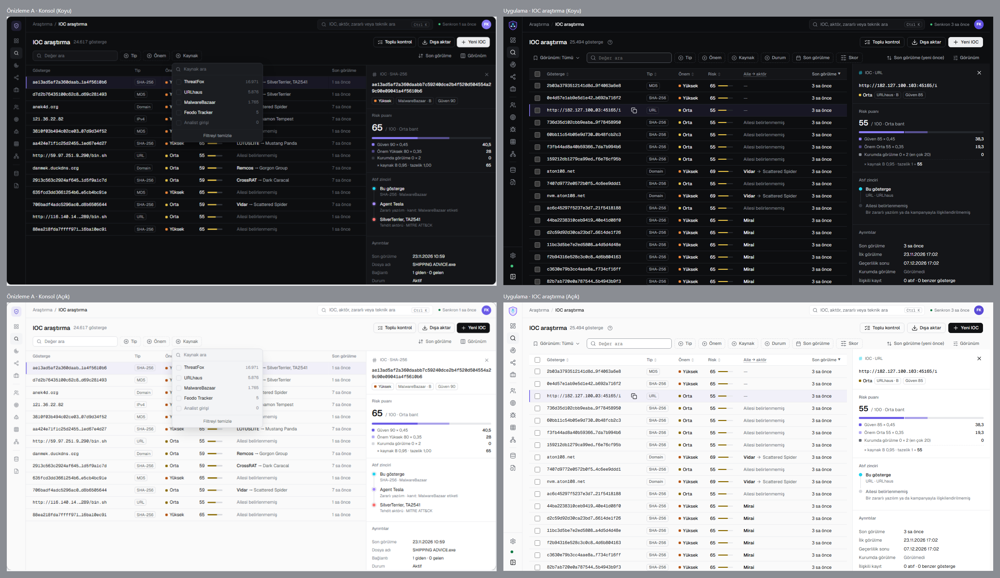

# ThreatLens · Konsol tasarımı raporu

Bu rapor `docs/CLAUDE_CODE_TASARIM_KONSOL.md` görevinin (A · Konsol yönü ve B · Dosya'dan üç parça) sonucudur. Her aşama ayrı commit'tir:

| Aşama | Commit | Konu |
|---|---|---|
| 1 | `ea90697` | Acil düzeltmeler |
| 2 | `d204c8f` | Tasarım belirteçleri |
| 3 | `2b91c74` | Uygulama kabuğu |
| 4 | `3e084dc`, `867dd76`, `27a8922` | Ortak bileşenler (filtre paneli, tablo, önizleme paneli, IOC detay) |
| 5 | `68dbad9` | Sayfa sayfa uygulama |
| 6 | `26cd95d` | Açık tema eşitliği |
| 7 | bu commit | Doğrulama ve rapor |
| 8 | — | Risk puanı ölçeği: onay bekliyor (§9, aşağıda) |

Önce: `docs/ui-audit/konsol-before/` (yalnızca koyu tema; tema seçeneği o sırada yoktu). Sonra: `docs/ui-audit/konsol-after/<tema>/<görünüm>/`. Depoda yalnızca `primary` (1440×790) görüntüleri tutulur; diğer görünüm alanları yerelde üretilir.

## Önizlemeyle karşılaştırma

Önizleme çerçeveleri: [koyu 1440](konsol-after/onizleme-A-dark-1440.png) · [açık 1440](konsol-after/onizleme-A-light-1440.png) · [koyu 390](konsol-after/onizleme-A-dark-390.png) · [açık 390](konsol-after/onizleme-A-light-390.png).

Kapatılan farklar (aşama 5): satır yüksekliği 42 → 36 px; panel açıkken "Aile → aktör" sütunu artık görünür (yalnızca öncelik-3 gizlenir); başlık eylemlerinin sırası önizlemeyle aynı.
Bilinçli kalan farklar: araç çubuğunda B · Dosya'dan alınan "Görünüm: Tümü" (kayıtlı görünümler), Durum / Son görülme / Skor filtreleri ve toplu seçim onay kutuları önizlemede yok; telefonda IOC listesi önizlemedeki tek satırlık kompakt satır yerine mevcut kart düzenini kullanır (aynı alanlar, öncelik-1).

## Madde madde durum

İşaretler: ✓ yapıldı · kısmen · yapılmadı. Sapmaların gerekçesi maddenin yanında.

### §0 Önce oku ve incele
- ✓ Belgeler ve yardımcılar okundu; önizleme Playwright ile 1440×790'da açıldı; mevcut durum `konsol-before/` altına çekildi; plan aşama başına yazıldı.

### §2 Aşama 1: acil düzeltmeler
- ✓ **Beyaz açılır listeler.** `select`, `option`, `optgroup` zemini ve metni tema yüzeyinden; tarih alanları `color-scheme: inherit`. Koyu tema seçili, işletim sistemi açık temadayken de kök `color-scheme: dark` (ölçüldü). Not: Windows'ta açılan yerel liste otomasyonla ekran görüntüsüne düşmüyor; hesaplanan renkler doğrulandı. Aşama 4'ten sonra araç çubuklarında yerel liste kalmadı; yalnızca formlarda (Yeni IOC, Yeni vaka, ATT&CK kapsam formu) var.
- ✓ **Alakasız filtre seçenekleri.** IOC kaynak listesi yalnızca IOC üreten kaynaklar (`EXISTS`); içe aktarma işleri filtresi yalnızca işi olan kaynaklar. Aşama 4'ten sonra tüm filtre seçenekleri sunucudaki sayılarla gelir; sayısı 0 olan seçenek soluk.
- ✓ **Genel bakışta çift sayı.** Şerit "son 24 saatte yüksek önem", KPI "Yüksek veya kritik önemli · tümü"; ikisi de tanımını ipucunda verir. "aktif" sayısı yalnızca Toplam IOC kartında. Senkron zamanı yalnızca üst çubukta (aşama 3).
- ✓ **Tekrarlanan başlıklar.** Ayarlar'da sekme adıyla aynı kart başlıkları yalnızca ekran okuyucuya; Denetim tablosunda "Gösterilen 25 / 190"; Veri kaynakları KPI "Kaynak · Hepsi etkin".
- ✓ **Satır satır tekrar eden metin.** "Sınıflandırılmamış", "ATT&CK ile eşleşmedi", "Atfedilmemiş" soluk "—" (anlamı ipucunda ve ekran okuyucuda); açıklama sütun başlığının ipucunda. "ATT&CK ile eşleşmedi" ayrı filtre seçeneği.

### §3 Aşama 2: tasarım belirteçleri
- ✓ Koyu ve açık bloklar aynı belirteç setini tanımlar; eski adlar (`--purple`, `--cyan` …) `--accent` / `--link`'e bağlı.
- ✓ Bileşen kurallarında sabit renk yok: yorumlar çıkarıldıktan sonra belirteç blokları dışında onaltılı renk **0** (aşama 7'de yeniden sayıldı). Gölge ve saydamlıklar `rgba()` ile belirteçlerde.
- ✓ Gradyanlar kalktı (yalnızca logo). Grafik ve çubuklar tek renk, sayılar nötr.
- ✓ Geist ve Geist Mono yerel (`app/static/vendor/fonts/`, SIL OFL lisansı `GEIST-OFL.txt`); `geist` paketinin 1.5.1 sürümünden (vercel/geist-font'un npm dağıtımı). Türkçe karakterler doğrulandı.
- ✓ Ölçek 12/13/14/17/22; gövde 13 px; sayısal hücrelerde `tabular-nums`. Kontrol 30 px, köşe 7 / 9 px, satır 36 / 44 px. Hareket 140 / 180 / 150 ms, `prefers-reduced-motion` destekli.
- Sapmalar: `--text-3` koyu `#888D96` (şartname `#71767F`: zeminde 4,2:1, seçili satırda daha az), açık `#696E76` (şartname `#80858D`: beyazda 3,7:1). Form alanı sınırı için `--ctl-line` eklendi (şartnamedeki `--line-strong` ~1,6:1; WCAG 1.4.11 3:1 ister). Açık temada renkli etiket zemini %8 ve yazı biraz koyu (4,5:1 için).

### §4 Aşama 3: uygulama kabuğu
- ✓ 56 px ikon şeridi (gruplar 20 px çizgi, ipucu balonu, altta Ayarlar ve bağlantı durumu); "Menüyü genişlet" 224 px etiketli menü, `tl-nav-expanded` (eski `tl-nav-collapsed=0` tercihi taşınır).
- ✓ 46 px üst çubuk: konum izi, 340 px Ctrl K araması, senkron durumu (hata varsa kırmızı, kaynak adı ipucunda; `/api/sync-status`), 28 px avatar.
- ✓ Başlık satırı: 17 px h1, soluk sayı, açıklama "?" ipucunda, ters birincil düğme en sağda.
- ✓ Telefon: 52 px çubuk, soldan çekmece menü.
- ✓ Kabul: `primary` ve `laptop`'ta kenar çubuğunda kaydırma yok (genişletilmiş menüde de); 13 sayfa yeni kabukta; Tab sırası atlama bağlantısı → menü → arama → senkron → avatar → "?" → sayfa eylemleri.
- Sapmalar: telefonda avatar da üst çubukta (çıkış ve tema yalnızca onun menüsünde); sayfaların klavye kısayolu olmadığı için ipucunda kısayol yok; 768–1023 px'te de ikon şeridi (şartname çekmeceyi yalnızca 768 altı için tanımlıyor).

### §5 Aşama 4: ortak bileşenler
- ✓ **Filtre düğmesi ve paneli** (§5.1): kesik çizgili düğme, seçimde düz çizgi ve "| değer" / "| 2 seçili"; 268 px `--elev` panel, arama (10'dan çok seçenekte odak aramada), onay kutusu / radyo, sağda sayı, altta "Filtreyi temizle"; anında uygulanır, adres çubuğunda tutulur, "Sıfırla ×".
- ✓ **Sayılar sunucudan** (`/api/<liste>/facets`): IOC, aktör, zararlı, kampanya, ATT&CK tekniği, denetim. Bir boyutun sayısı diğer etkin filtreleri uygular, kendisini uygulamaz. Basit boyutlar tek taramada (`GROUPING SETS`, boyut koşulları satır bayrağına dönüşür), çoka-çok boyutlar `COUNT(DISTINCT)` ile. Ölçüm (canlı veri, 25.494 IOC): IOC sayıları filtresiz 17 ms, önem + tip filtresiyle 41 ms, metin aramasıyla 73 ms (medyan; hedef 150 ms). Aktör 5 ms, zararlı 9 ms, teknik 21 ms. Denetim kaydı sayıları ~151 ms: 'otomasyon kayıtlarını gizle' koşulu AuditLog'u tarar; şartname AuditLog'a dokunmayı yasakladığı için indeks eklenmedi.
- ✓ **Erişilebilirlik:** düğmede `aria-haspopup`, `aria-expanded`; panel `role="listbox"` (çoklu seçimde `aria-multiselectable`), ok tuşları / Home / End, Space seçer, Esc kapatıp odağı düğmeye verir, dış tıklama kapatır.
- ✓ **Sırala, Görünüm (sütunlar, yoğunluk, sayfa başına) ve tarih aralığı** aynı panel yüzeyiyle (`role="menu"`); hazır aralıklar Son 24 saat / 7 gün / 30 gün.
- ✓ **Telefon:** filtre düğmeleri yatay kayan çip dizisi; panel alttan açılan sayfa.
- ✓ **Tablo** (§5.2): kart dışında, 32 px yapışkan başlık, 36 px satır, yalnızca alt çizgi, seçili satırda 2 px vurgu; gösterge Mono + ortadan kısaltma + hover'da kopyalama; tip çerçeveli etiket; önem nokta + metin; risk sayı + bant çubuğu; aile → aktör; göreli zaman; alt satır "1–25 / 25.494 · Sayfa başına 25". Panel açıkken öncelik-3 sütunları gizli; ↑/↓ satır değiştirir (panel de), Space paneli, Enter tam sayfayı açar; toplu seçim korunur.
- ✓ **Detay paneli** (§5.3): ≥1280 384 px bölünmüş, 768–1279 çekmece, <768 alt sayfa. IOC bölümleri: başlık, risk puanı ve bileşenleri, dikey atıf zinciri, ayrıntılar, teknikler (5 + "+N"), yapışkan eylemler. Aktör, zararlı ve kampanya panelleri şartnamedeki bölümleri içerir ve eylemleri alttaki yapışkan çubuktadır.
- ✓ **`fn_RiskBreakdown`:** yeni nesne gerekmedi; satır içi tablo değerli fonksiyon zaten vardı (`database/functions/03_functions.sql`), `vw_Indicator` ve `fn_RiskScore` aynı formülü bundan alır; eşitlik testi mevcut (`test_risk_breakdown_matches_score`). Arayüz formülü yeniden yazmaz.
- ✓ **B · Dosya** (§5.4): kayıtlı görünümler (IOC 4, aktör 2, zararlı 2; sayılarıyla, adreste, genel bakıştan bağlantılı); IOC detay dosya düzeni (sekmeler, yarım halka gösterge, yatay zincir, özellik listesi, teknik çipleri, geçmiş farkı); filtre seçeneklerinde 2 px oran çubuğu.
- ✓ **Diğer parçalar** (§5.5): tek rozet bileşeni, KPI kartı (22 px sayı, soluk 16 px ikon), boş durum, ipucu / toast / pencere yeni belirteçlerle.
- ✓ **Kabul:** araç çubuklarında yerel `<select>` yok (`grep` yalnızca ATT&CK kapsam formundaki aktör seçimini bulur: form); filtre paneli klavyeyle tam kullanılır; sayılar `COUNT(*)` ile eşleşir (4 test: IOC, zararlı + aktör, teknik + kampanya, kayıtlı görünümler).
- Sapmalar: iki "Görünüm" düğmesi (solda kayıtlı görünüm, sağda tablo görünümü) şartnameye uygun; ekran okuyucu adları farklı. IOC listesinde Güven ve İlk görülme varsayılan gizli (Görünüm menüsünden açılır). Zararlılarda "Yer tutucuları göster" onay kutusu "Yer tutucular" filtresine dönüştü (Dahil et / Yalnızca); kampanyalara "Atıf" filtresi eklendi. Telefonda IOC alt sayfası Ayrıntılar ve Teknikler bölümlerini gizler ("Kayda git" tam sayfaya götürür).

### §6 Aşama 5: sayfa sayfa
- ✓ **IOC araştırma:** önizlemeyle yan yana karşılaştırıldı, farklar kapatıldı (yukarıda). Yeni IOC iki kolon, 1440×790'da kaydırmasız; Toplu kontrolde canlı değer sayacı.
- ✓ **IOC detay:** §5.4-2 dosya düzeni.
- ✓ **Aktörler, zararlılar, kampanyalar:** liste + önizleme paneli; takma adlar en çok 3 + "+N"; tümü "—" olan sütunlar varsayılan gizli; "Atfedilmemiş" soluk "—"; "ATT&CK ile eşleşmedi" filtre.
- ✓ **MITRE ATT&CK:** 15 taktik tek satırlık çip şeridi ("Execution 22 · 18", ayrıntı ipucunda); kampanya filtresi aranabilir panelde; matris ve kapsama yeni belirteçlerle.
- ✓ **Altyapı örtüşmesi:** ülke dağılımı kompakt şerit (en çok 8 + Diğer), iki tablo tam genişlikte alt alta. Yan yana düzen denendi ([A](konsol-asama5/infra-a.png) · [B](konsol-asama5/infra-b.png)): ikisinde de boş alan yok ama yan yana ASN tablosu yatay kaydırmaya düşüyor, Aile / Aktör sütunları görünmüyor; A seçildi.
- ✓ **Veri kaynakları:** tablolar sayfa zemininde, birimler korunur, senkron ikon + satır menüsü, işler aynı.
- ✓ **Denetim kayıtları:** grafik 160 px, tek tepede en büyük günün değeri yazılır; filtreler ve tarih aralığı panel bileşeninde; satır seçimi önce / sonra farkını panelde açar.
- ✓ **Ayarlar:** kullanıcılar ve yetki matrisi eşit yükseklikte iki kolon, matris 36 px satır (✓ / —); risk sekmesinde iki kart eşit yükseklikte; Kaydet yalnızca değişiklik varken etkin.
- ✓ **Vakalar:** boş durum liste kartında; sağda Vaka şablonları (Oltalama, C2 iletişimi, Kimlik bilgisi sızıntısı → dolu Yeni vaka) ve Son log avları (son 5, eşleşme sayısıyla). "Bu avdan vaka aç" vakayı açar ve avın eşleşen IOC'lerini tek işlemde ekler; `/hunt?id=N` geçmiş avı açar. Vaka detayındaki etkinlik akışı yeni belirteçlerle.
- ✓ **Genel bakış:** tekrarlar kalktı; dikkat şeridi kayıtlı görünümlere bağlanır; KPI yeni stil; tip dağılımı tek renk; kaynaklar kompakt sağlık satırı; tüm IOC'ler tek bantta ise "Tüm IOC'ler Orta bantta: puan ölçeği bkz. Ayarlar".
- ✓ **Log avı:** yapı korundu; belirteçler ve tablo stili; Vakaya ekle ikon + metin.
- kısmen **İlişki grafı:** kontrol çubuğu, sağ panel ve ilişki tablosu yeni belirteçlerle; tuval koyu, düğüm renkleri aynı. Kontrol çubuğu hâlâ bir kart içinde (araç çubuğu düzenine taşınmadı).
- ✓ **Giriş:** form tek yüzey (`--card`), sol taraf sakin; hata ve Caps Lock uyarıları korunur.

### §7 Aşama 6: açık tema eşitliği
- ✓ Üç yüzey: zemin `#FAFAFA`, yüzey beyaz, yükseltilmiş `#F3F4F6`; aynı tonda kart yok (tema denetimi).
- ✓ Açılır panellerde yumuşak `--shadow-pop`.
- ✓ Graf tuvali ve kod blokları `.force-dark`; çevrelerindeki kontroller açık temada. Kod blokları (SQL çekmecesi, en pahalı sorgular) aşama 6'da açıkça `.force-dark` oldu (yorum metni açık temanın rengini alıyordu).

### §8 Aşama 7: doğrulama
- ✓ `scripts/ui_screenshots.py --themes dark,light` → `konsol-after/<tema>/<görünüm>/<sayfa>.png`; her listede filtre paneli (`*-facet`, `iocs-date`) ve detay paneli (`*-panel`) açık hâlleri de çekilir.
- ✓ Önizleme çerçeveleri (koyu / açık, 1440 / 390) ve `karsilastirma.png` (`scripts/konsol_compare.py`).
- ✓ Otomatik denetim: `scripts/theme_audit.py` (yanlış tonda yüzey, aynı tonda kart, 12–14 px metin kontrastı, araç çubuğunda yerel select) ve `scripts/ui_screenshots.py` (taşma, kenar çubuğu kaydırması, iç kaydırma, kesik ama ipucusuz metin, çakışma, konsol hatası). Taşma denetimi aşama 5'te güçlendirildi: içerik alanında kırpılan (`overflow-x: clip` yüzünden görünmeyen) öğeler de sayılır.
- ✓ `scripts/a11y_audit.py`: kritik ihlal 0; genel bakış, IOC araştırma ve ilişki grafı ≥ 90 (sonuçlar aşağıda).
- ✓ `pytest`: 171 test geçti; yeni testler: facet sayıları (4), senkron durumu, IOC kaynak listesi, zararlı ATT&CK filtresi; canlı veritabanı koruma testi geçer.

### §9 Aşama 8: risk puanı ölçeği
- yapılmadı: şartname gereği onay bekliyor. İki seçenek ve her birinin mevcut veride bant dağılımı ayrıca sunulacak; seçimden sonra `database/functions/03_functions.sql`, açıklama ve testler güncellenecek.

## Otomatik denetim sonuçları

### Düzen denetimi (önce → sonra)

Önce: `konsol-before` (aşama 1 öncesi, yalnızca koyu). Sonra: `konsol-after`, iki tema. Hücreler: taşan sayfa · kenar çubuğu kaydırması · istenmeyen iç kaydırma · kesik ve ipucusuz metin · çakışma · konsol hatası.

| Görünüm | Önce (koyu) | Sonra · koyu | Sonra · açık |
|---|---|---|---|
| `primary` 1440×790 | 0 · 0 · 0 · 0 · 0 · 0 <small>(28 sayfa)</small> | **0 · 0 · 0 · 0 · 0 · 0 <small>(36 sayfa)</small>** | **0 · 0 · 0 · 0 · 0 · 0 <small>(36 sayfa)</small>** |
| `wide` 1920×1000 | 0 · 0 · 0 · 0 · 0 · 0 <small>(28 sayfa)</small> | **0 · 0 · 0 · 0 · 0 · 0 <small>(36 sayfa)</small>** | **0 · 0 · 0 · 0 · 0 · 0 <small>(36 sayfa)</small>** |
| `laptop` 1280×720 | 0 · 0 · 0 · 0 · 0 · 0 <small>(28 sayfa)</small> | **0 · 0 · 0 · 0 · 0 · 0 <small>(36 sayfa)</small>** | **0 · 0 · 0 · 0 · 0 · 0 <small>(36 sayfa)</small>** |
| `tablet` 1024×768 | 0 · 0 · 0 · 0 · 0 · 0 <small>(28 sayfa)</small> | **0 · 0 · 0 · 0 · 0 · 0 <small>(36 sayfa)</small>** | **0 · 0 · 0 · 0 · 0 · 0 <small>(36 sayfa)</small>** |
| `mobile` 390×844 | 0 · 0 · 0 · 0 · 0 · 0 <small>(28 sayfa)</small> | **0 · 0 · 0 · 0 · 0 · 0 <small>(36 sayfa)</small>** | **0 · 0 · 0 · 0 · 0 · 0 <small>(36 sayfa)</small>** |

"Önce" sütunu bir önceki arayüz turunun (UI aşama 5) sonundaki temiz durumdur; o sırada taşma denetimi içerik alanında kırpılan öğeleri saymıyordu. Güçlendirilmiş denetim bu turda iki gerçek hatayı yakaladı ve kapattı (ATT&CK listesinin 2.351 px'e genişleyip görünüm düğmesini ve sayfalayıcıyı ekran dışına itmesi; telefonda araç çubuğu, graf ilişki tablosu ve denetim KPI'larının taşması). Sonra sütununda sayfa sayısı fazladır: açık filtre paneli ve detay paneli durumları eklendi.

İzin verilen kaydırmalar (sayılmaz): sağ detay paneli, pencere gövdesi, yatay kaydırmalı tablo ve ATT&CK matrisi, ATT&CK taktik şeridi, telefonda filtre düğmeleri şeridi, IOC detay sekmeleri ve açılır filtre panelindeki seçenek listesi (en çok 320 px; yerel açılır listenin karşılığı).

### Tema denetimi (`theme.json`, 1440×790)

| Tema | Denetlenen görünüm | Yanlış tonda yüzey | Aynı tonda kart | Düşük kontrast (12–14 px) | Araç çubuğunda yerel select |
|---|---|---|---|---|---|
| Koyu | 38 | **0** | **0** | **0** | **0** |
| Açık | 38 | **0** | **0** | **0** | **0** |

### Erişilebilirlik (axe-core 4.10.2, WCAG 2.1 A/AA + en iyi uygulamalar, 1440×790)

| Tema | Sayfa | Puan | Kritik | Ciddi | İhlal |
|---|---|---|---|---|---|
| Koyu | overview | **100** | 0 | 0 | 0 |
| Koyu | iocs | **100** | 0 | 0 | 0 |
| Koyu | graph-hash | **100** | 0 | 0 | 0 |
| Koyu | tüm 27 sayfa | en düşük **100** | 0 | 0 | 0 |
| Açık | overview | **100** | 0 | 0 | 0 |
| Açık | iocs | **100** | 0 | 0 | 0 |
| Açık | graph-hash | **100** | 0 | 0 | 0 |
| Açık | tüm 27 sayfa | en düşük **100** | 0 | 0 | 0 |

## Ekran görüntüleri (1440×790)

Önce yalnızca koyu temadadır. Yeni sayfa durumları (`*-facet`, `iocs-panel`, `iocs-date`) önce çekilmediği için "—".

| Sayfa | Önce | Sonra · koyu | Sonra · açık |
|---|---|---|---|
| actors | [önce](konsol-before/primary/actors.png) | [koyu](konsol-after/dark/primary/actors.png) | [açık](konsol-after/light/primary/actors.png) |
| actors-facet | — | [koyu](konsol-after/dark/primary/actors-facet.png) | [açık](konsol-after/light/primary/actors-facet.png) |
| actors-panel | [önce](konsol-before/primary/actors-panel.png) | [koyu](konsol-after/dark/primary/actors-panel.png) | [açık](konsol-after/light/primary/actors-panel.png) |
| attack-coverage | [önce](konsol-before/primary/attack-coverage.png) | [koyu](konsol-after/dark/primary/attack-coverage.png) | [açık](konsol-after/light/primary/attack-coverage.png) |
| attack-facet | — | [koyu](konsol-after/dark/primary/attack-facet.png) | [açık](konsol-after/light/primary/attack-facet.png) |
| attack-list | [önce](konsol-before/primary/attack-list.png) | [koyu](konsol-after/dark/primary/attack-list.png) | [açık](konsol-after/light/primary/attack-list.png) |
| attack-matrix | [önce](konsol-before/primary/attack-matrix.png) | [koyu](konsol-after/dark/primary/attack-matrix.png) | [açık](konsol-after/light/primary/attack-matrix.png) |
| audit | [önce](konsol-before/primary/audit.png) | [koyu](konsol-after/dark/primary/audit.png) | [açık](konsol-after/light/primary/audit.png) |
| audit-facet | — | [koyu](konsol-after/dark/primary/audit-facet.png) | [açık](konsol-after/light/primary/audit-facet.png) |
| audit-logins | [önce](konsol-before/primary/audit-logins.png) | [koyu](konsol-after/dark/primary/audit-logins.png) | [açık](konsol-after/light/primary/audit-logins.png) |
| audit-runs | [önce](konsol-before/primary/audit-runs.png) | [koyu](konsol-after/dark/primary/audit-runs.png) | [açık](konsol-after/light/primary/audit-runs.png) |
| campaigns | [önce](konsol-before/primary/campaigns.png) | [koyu](konsol-after/dark/primary/campaigns.png) | [açık](konsol-after/light/primary/campaigns.png) |
| campaigns-facet | — | [koyu](konsol-after/dark/primary/campaigns-facet.png) | [açık](konsol-after/light/primary/campaigns-facet.png) |
| campaigns-panel | [önce](konsol-before/primary/campaigns-panel.png) | [koyu](konsol-after/dark/primary/campaigns-panel.png) | [açık](konsol-after/light/primary/campaigns-panel.png) |
| cases | [önce](konsol-before/primary/cases.png) | [koyu](konsol-after/dark/primary/cases.png) | [açık](konsol-after/light/primary/cases.png) |
| graph-empty | [önce](konsol-before/primary/graph-empty.png) | [koyu](konsol-after/dark/primary/graph-empty.png) | [açık](konsol-after/light/primary/graph-empty.png) |
| graph-hash | [önce](konsol-before/primary/graph-hash.png) | [koyu](konsol-after/dark/primary/graph-hash.png) | [açık](konsol-after/light/primary/graph-hash.png) |
| hunt | [önce](konsol-before/primary/hunt.png) | [koyu](konsol-after/dark/primary/hunt.png) | [açık](konsol-after/light/primary/hunt.png) |
| infrastructure | [önce](konsol-before/primary/infrastructure.png) | [koyu](konsol-after/dark/primary/infrastructure.png) | [açık](konsol-after/light/primary/infrastructure.png) |
| ioc-detail | [önce](konsol-before/primary/ioc-detail.png) | [koyu](konsol-after/dark/primary/ioc-detail.png) | [açık](konsol-after/light/primary/ioc-detail.png) |
| ioc-lookup-dialog | [önce](konsol-before/primary/ioc-lookup-dialog.png) | [koyu](konsol-after/dark/primary/ioc-lookup-dialog.png) | [açık](konsol-after/light/primary/ioc-lookup-dialog.png) |
| ioc-new-dialog | [önce](konsol-before/primary/ioc-new-dialog.png) | [koyu](konsol-after/dark/primary/ioc-new-dialog.png) | [açık](konsol-after/light/primary/ioc-new-dialog.png) |
| iocs | [önce](konsol-before/primary/iocs.png) | [koyu](konsol-after/dark/primary/iocs.png) | [açık](konsol-after/light/primary/iocs.png) |
| iocs-date | — | [koyu](konsol-after/dark/primary/iocs-date.png) | [açık](konsol-after/light/primary/iocs-date.png) |
| iocs-facet | — | [koyu](konsol-after/dark/primary/iocs-facet.png) | [açık](konsol-after/light/primary/iocs-facet.png) |
| iocs-panel | — | [koyu](konsol-after/dark/primary/iocs-panel.png) | [açık](konsol-after/light/primary/iocs-panel.png) |
| login | [önce](konsol-before/primary/login.png) | [koyu](konsol-after/dark/primary/login.png) | [açık](konsol-after/light/primary/login.png) |
| malware | [önce](konsol-before/primary/malware.png) | [koyu](konsol-after/dark/primary/malware.png) | [açık](konsol-after/light/primary/malware.png) |
| malware-facet | — | [koyu](konsol-after/dark/primary/malware-facet.png) | [açık](konsol-after/light/primary/malware-facet.png) |
| malware-panel | [önce](konsol-before/primary/malware-panel.png) | [koyu](konsol-after/dark/primary/malware-panel.png) | [açık](konsol-after/light/primary/malware-panel.png) |
| overview | [önce](konsol-before/primary/overview.png) | [koyu](konsol-after/dark/primary/overview.png) | [açık](konsol-after/light/primary/overview.png) |
| settings | [önce](konsol-before/primary/settings.png) | [koyu](konsol-after/dark/primary/settings.png) | [açık](konsol-after/light/primary/settings.png) |
| settings-integrations | [önce](konsol-before/primary/settings-integrations.png) | [koyu](konsol-after/dark/primary/settings-integrations.png) | [açık](konsol-after/light/primary/settings-integrations.png) |
| settings-maintenance | [önce](konsol-before/primary/settings-maintenance.png) | [koyu](konsol-after/dark/primary/settings-maintenance.png) | [açık](konsol-after/light/primary/settings-maintenance.png) |
| settings-risk | [önce](konsol-before/primary/settings-risk.png) | [koyu](konsol-after/dark/primary/settings-risk.png) | [açık](konsol-after/light/primary/settings-risk.png) |
| sources | [önce](konsol-before/primary/sources.png) | [koyu](konsol-after/dark/primary/sources.png) | [açık](konsol-after/light/primary/sources.png) |

## Bilinen sınırlamalar

- **Aşama 8 bekliyor.** Risk dağılımı hâlâ "%100 Orta" gösterir; genel bakış bunu açıklayan notu verir.
- **Yerel açılır liste görüntüsü.** Windows'ta açılan yerel `select` listesi tarayıcı otomasyonunun ekran görüntüsüne düşmez; renkler hesaplanan stille doğrulandı. Araç çubuklarında yerel liste kalmadı; formlarda kaldı (şartnamenin izin verdiği yer).
- **İlişki grafı kontrol çubuğu** hâlâ kart içinde.
- **Telefon IOC listesi** önizlemedeki tek satırlık kompakt satır yerine kart düzenini kullanır.
- **Puanlar Lighthouse değildir.** Erişilebilirlik puanı axe sonuçlarından Lighthouse'a benzer ağırlıklandırmayla hesaplanır; pencereler (Yeni IOC, Toplu kontrol) axe kapsamında değil, tema denetiminde var.
- **Önce görüntüleri** tek temadır; tema denetiminin "önce" sonucu yok (betik aşama 6'da yazıldı).
- **Tasarım referansları.** `docs/design-references/*.png` (9 dosya) çalışma ağacında silinmiş görünüyor; commit'e katılmadı, geri yüklenmedi (karar bekleniyor).
